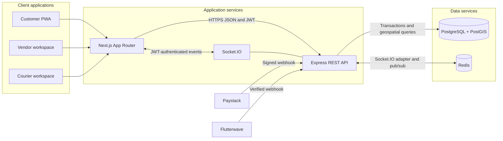
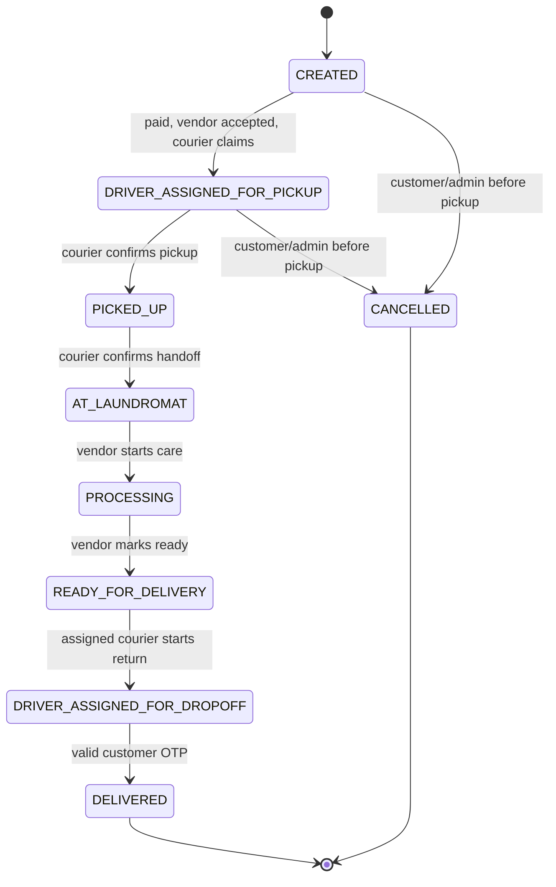
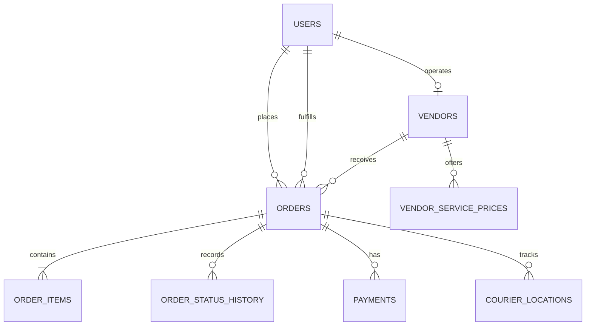

# Laundry Map

**Neighborhood laundry, from pickup to doorstep.**

Laundry Map is a multi-persona laundry marketplace for a pilot in the Karu and Mararaba corridor of Nasarawa State, Nigeria. Customers choose local laundry services and arrange pickup and delivery. Vendors accept and process orders. Couriers handle both delivery legs with live order tracking.

This repository is an npm-workspaces monorepo. It includes a Next.js Progressive Web App, an Express and Socket.IO API, PostgreSQL with PostGIS, Redis, Docker Compose, and a GitHub Codespaces development container.

> **Deployment status:** Production startup now requires externally managed secrets, HTTPS public origins, TLS PostgreSQL, and authenticated TLS Redis. Validate migrations, provider webhooks, backups, and proxy behavior against the actual managed services in staging before handling live orders.

## Contents

- [Capabilities](#capabilities)
- [System Architecture](#system-architecture)
- [Order Lifecycle](#order-lifecycle)
- [Technology and Repository Layout](#technology-and-repository-layout)
- [Quick Start](#quick-start)
- [Configuration](#configuration)
- [Personas and Workflows](#personas-and-workflows)
- [API Reference](#api-reference)
- [Real-Time Events](#real-time-events)
- [Data and Performance](#data-and-performance)
- [Security and Payments](#security-and-payments)
- [Testing and Quality](#testing-and-quality)
- [Partner Provisioning](#partner-provisioning)
- [Production Readiness](#production-readiness)
- [Current Boundaries](#current-boundaries)

## Capabilities

- Customer, vendor, and courier workspaces in one responsive PWA.
- Wash & Fold, Dry Cleaning, and Ironing services with vendor-specific catalog pricing.
- Nearby vendor search using PostGIS geography and Karu/Mararaba pilot seed data.
- Transactional order creation, status history, server-calculated commission, and row-locked state transitions.
- Paystack and Flutterwave checkout initialization with signed, idempotent webhooks and payment-reconciliation logging.
- Two-minute vendor acceptance window, first-come courier assignment, dual-leg routing, and customer delivery-code verification.
- JWT-authenticated Socket.IO events with Redis adapter support for multi-instance fan-out.
- Opt-in courier location sharing, network-only API requests, and an offline-resilient PWA shell.
- Partner account provisioning through an operations CLI; public registration is customer-only.

## System Architecture



The API owns validation, pricing, authorization, order transitions, and payment confirmation. PostgreSQL is the source of truth. Redis distributes Socket.IO events between API instances; it is not the order database. The browser never determines an order's final price or payment state.

### Request and Event Flow

1. A customer selects a vendor and services in the PWA.
2. The API validates the request, reads prices from that vendor's catalog, and creates the order and item rows in one database transaction.
3. The customer chooses Paystack or Flutterwave and is redirected to the selected provider. A browser redirect alone does not mark the order paid.
4. The provider webhook signature and unique event ID are checked; reference, amount, and NGN currency are verified before payment and order state are updated transactionally.
5. The vendor receives a real-time paid-order event and has two minutes to accept.
6. A courier claims an eligible dispatch. The same courier handles pickup and return; authenticated status and location events are sent to authorized order subscribers.
7. The courier completes delivery only after validating the customer's six-digit code.

## Order Lifecycle



State transitions are checked in application code and performed under `SELECT ... FOR UPDATE`, preventing concurrent requests from advancing the same order twice. Paid-order cancellation is rejected until an operations-managed refund is available. The acceptance deadline starts when payment is confirmed, not when an unpaid order is first created.

## Technology and Repository Layout

| Area | Implementation |
| --- | --- |
| Web | Next.js 16 App Router, React 19, TypeScript, Tailwind CSS, Lucide icons |
| API | Node.js 22, Express 4, TypeScript, Zod |
| Real time | Socket.IO with Redis adapter |
| Persistence | PostgreSQL 16, PostGIS, parameterized SQL, `pg` connection pool |
| Authentication | bcrypt password hashing and signed JWTs |
| Local infrastructure | Docker Compose, PostGIS and Redis health checks |
| Development environment | GitHub Codespaces dev container with Docker-in-Docker feature |

```text
.
├── .devcontainer/
│   └── devcontainer.json
├── backend/
│   ├── db/                 # Initial schema and pilot seed data
│   └── src/                # Auth, API, orders, lifecycle, provisioning CLI
├── frontend/
│   ├── app/                # Customer, vendor, courier PWA
│   └── public/             # Manifest, icons, service worker
├── docker-compose.yml      # Development and production profiles
├── package.json            # npm workspace scripts
└── README.md
```

## Quick Start

### GitHub Codespaces

Open the repository in a Codespace and reopen it in the configured dev container. It starts PostgreSQL/PostGIS, Redis, and the development app service. The app container installs dependencies and runs both workspaces.

For local Docker Compose development:

```sh
cp .env.example .env
docker compose --profile development up --build
```

Open the forwarded **3000** port for the PWA. The API listens on **4000**. PostgreSQL and authenticated Redis are available on **5432** and **6379** for local tools. Compose waits for both data services' health checks, applies pending migrations, and then starts the application.

### Host-Based Development

Requirements: Node.js 22 (the workspace supports Node.js 20.11 or later) and Docker Compose v2.

```sh
docker compose --profile development up -d postgres redis
cp backend/.env.example backend/.env
cp frontend/.env.example frontend/.env.local
docker compose --profile development up -d postgres redis
npm ci
npm run dev
```

The backend loads `backend/.env`; Next.js loads `frontend/.env.local`. Apply pending schema changes with `npm run migrate:dev -w @laundry-map/backend` after the database is available. To stop the data services, run `docker compose --profile development down`. The named database volume persists across restarts. The image initialization scripts seed only a new, empty data directory; later schema changes use the migration runner.

> `docker compose down -v` deletes the persistent database and Redis volumes. Use it only when you intentionally want to erase local data and reload the seed.

### Workspace Commands

| Command | Purpose |
| --- | --- |
| `npm run dev` | Run API and web development servers concurrently |
| `npm run typecheck` | Typecheck both workspaces |
| `npm test` | Run backend, frontend, API, payment verification, and service-worker tests |
| `NEXT_PUBLIC_API_URL=https://api.example.com npm run build` | Build backend and Next.js frontend with the required public API origin |
| `npm run migrate:dev -w @laundry-map/backend` | Apply tracked schema migrations from a development shell |
| `npm run provision:partner -w @laundry-map/backend` | Create a vendor or courier account |

## Configuration

Compose reads the root `.env`. For direct host development, use the backend and frontend env examples in their respective workspaces.

| Variable | Used by | Description |
| --- | --- | --- |
| `JWT_SECRET` | API, Compose | Environment-store secret for signing and OTP encryption; at least 32 characters. Required in every profile and has no production fallback. |
| `JWT_EXPIRES_IN` | API | JWT lifetime; defaults to `12h`. |
| `WEB_ORIGIN` | API | Comma-separated valid browser origins; HTTPS is mandatory in production. |
| `DATABASE_URL` | API | PostgreSQL connection string. Production value must be supplied by the deployment secret store. |
| `DATABASE_SSL` | API | Must be `true` in production; certificate validation is enabled. |
| `REDIS_URL` | API | Development Redis URL may use local credentials; production must use authenticated `rediss://`. |
| `NEXT_PUBLIC_API_URL` | Web and API | Required public API URL; HTTPS is mandatory in production and it is embedded at web build time. |
| `PAYSTACK_SECRET_KEY` | API | Environment-store secret for Paystack initialization and HMAC-SHA512 webhook verification. |
| `FLUTTERWAVE_SECRET_KEY` | API | Environment-store secret for Flutterwave checkout initialization. |
| `FLUTTERWAVE_SECRET_HASH` | API | Environment-store secret used to verify Flutterwave webhook HMAC signatures over the raw body. |
| `TRUST_PROXY` | API | Trusted proxy hop count or address list; production must set this to match the ingress topology. |
| `SOCKET_IO_TRANSPORTS` | API | Comma-separated `websocket` and/or `polling`; production polling requires sticky sessions at the load balancer. |

Do not commit `.env` files, production keys, credentials, or customer data. Example values are for local development only. The Compose `production` profile rejects missing secrets and has no credential or URL fallback.

## Personas and Workflows

### Customer

- Browse nearby laundromats and current service pricing.
- Select Wash & Fold, Dry Cleaning, or Ironing.
- Enter pickup and delivery addresses; location coordinates are requested only after tapping **Use my location**.
- Pay through Paystack and follow payment state, order history, courier location, and the delivery code.

### Vendor

- Sign in with an operations-provisioned vendor account.
- Receive a paid order with a server-issued two-minute acceptance deadline and an audio alert.
- Accept the order, move it through processing, and mark it ready for delivery.

### Courier

- Sign in with an operations-provisioned courier account.
- Claim a paid, vendor-accepted dispatch; assignments are atomic and first-come.
- Navigate the customer-to-laundromat pickup leg and the laundromat-to-customer return leg.
- Optionally share live location; confirm final delivery with the customer's six-digit code.

## API Reference

All routes are served from the API origin. Routes marked **JWT** require `Authorization: Bearer <token>`.

| Method and path | Access | Purpose |
| --- | --- | --- |
| `GET /health/live` | Public | Process liveness |
| `GET /health/ready` | Public | PostgreSQL and Redis readiness |
| `POST /api/auth/register` | Public | Register a customer |
| `POST /api/auth/login` | Public | Authenticate a customer, vendor, or courier |
| `GET /api/vendors?latitude=...&longitude=...` | Public | Find nearby active vendors and services |
| `POST /api/orders` | Customer JWT | Create order with server-side catalog pricing |
| `GET /api/orders` | Customer JWT | List customer's orders and timeline |
| `GET /api/orders/:id` | Participant JWT | Read an order visible to the caller |
| `PATCH /api/orders/:id/status` | Participant JWT | Request a role-authorized lifecycle transition; customer cancellation is limited to before pickup |
| `POST /api/payments/initialize` | Customer JWT | Initialize Paystack or Flutterwave checkout with `{ "orderId": "...", "provider": "PAYSTACK" }` or `FLUTTERWAVE` |
| `POST /api/payments/paystack/webhook` | Paystack signature | Verify and confirm a Paystack payment |
| `POST /api/payments/flutterwave/webhook` | Flutterwave hash | Verify and confirm a Flutterwave payment |
| `GET /api/vendor/orders` | Vendor JWT | List paid vendor orders |
| `POST /api/vendor/orders/:id/accept` | Vendor JWT | Accept within the response window |
| `GET /api/courier/jobs` | Courier JWT | List eligible and assigned jobs |
| `POST /api/courier/jobs/:id/accept` | Courier JWT | Claim an available dispatch |
| `POST /api/courier/jobs/:id/complete` | Assigned courier JWT | Verify OTP and complete delivery |

Order creation accepts `vendorId`, pickup/delivery addresses and coordinates, and `items` containing a `service` and integer `quantity`. Any client-supplied price is not used. Values are validated at the API boundary.

## Real-Time Events

Socket.IO connects to the API origin with the JWT in the handshake auth payload:

```ts
io(API_URL, { auth: { token } });
```

| Direction | Event | Payload / behavior |
| --- | --- | --- |
| Client to server | `order:subscribe` | Order ID; joins only if the caller is an authorized participant |
| Client to server | `driver:location` | `{ orderId, latitude, longitude }`; courier-only, validated and persisted as the latest point |
| Client to server | `health:ping` | Acknowledges an authenticated WebSocket round trip with a server timestamp |
| Server to client | `order:created` | Newly paid order available to its customer or vendor |
| Server to client | `order:status` | Status or payment-state update for authorized order participants |
| Server to client | `vendor:accepted` | Vendor acceptance event for the order room |
| Server to client | `dispatch:available` | Signals courier clients to refresh eligible jobs |
| Server to client | `driver:location` | Latest courier coordinates for subscribed order clients |

The Redis adapter allows Socket.IO events to cross API instances. Production configures an HTTP-only secure affinity cookie and honors forwarded headers only from the `TRUST_PROXY` addresses/hops. The ingress must forward `X-Forwarded-Proto` and WebSocket upgrade headers. If polling is enabled behind a multi-instance load balancer, configure cookie-based sticky sessions; alternatively set `SOCKET_IO_TRANSPORTS=websocket` where clients and ingress support it.

## Data and Performance



- Monetary values are stored as integer kobo; API catalog prices are loaded from `vendor_service_prices` and totals are calculated server-side.
- Vendor locations and order addresses use PostGIS `GEOGRAPHY(POINT, 4326)`. A GIST index supports nearby vendor lookup.
- Orders, order items, history, payment confirmation, and courier assignment use PostgreSQL transactions where consistency matters.
- Common customer, vendor, courier, payment, and history access paths have dedicated indexes. Vendor search returns at most 30 results; order queues are capped at 100.
- The PostgreSQL pool is capped at 20 connections per API instance. Account for the aggregate pool size when scaling instances against a managed database's connection limit.
- Courier location sharing upserts one latest point per courier/order pair and removes it when delivery completes; the application does not retain a growing breadcrumb trail.
- Redis is used for Socket.IO fan-out. PostgreSQL remains authoritative for orders, payments, vendor catalog, and order history.

These are implementation choices, not benchmark claims. Measure query plans, pool saturation, event latency, and API response times with pilot traffic before setting performance targets.

## Security and Payments

- Passwords are hashed with bcrypt; request bodies and coordinates are validated with Zod.
- JWT authentication and role checks protect REST routes and Socket.IO subscriptions. Order-room membership is checked against the database.
- Helmet, CORS allowlisting, and API rate limiting are enabled.
- Paystack signatures use HMAC-SHA512 and Flutterwave signatures use HMAC-SHA256; both use constant-time comparison against the exact raw body. Legacy shared-hash-only Flutterwave headers are rejected.
- Webhook event IDs are persisted with payload hashes to make retries idempotent. Confirmations require a matching initialized provider reference, exact amount, and NGN currency. Payment, order, and webhook event updates share a database transaction.
- Invalid amounts/currencies, unknown references, late payment events, and cancellation races are written to reconciliation logs; they never mark a cancelled order paid.
- Delivery codes are generated with a cryptographically secure random source. The database stores a bcrypt verification hash and a separately AES-GCM-encrypted copy so the customer can retrieve the code after signing in. The encryption key is derived from `JWT_SECRET`; protect and rotate that key accordingly.
- API requests are never cached by the service worker. Navigations use a network-first strategy with the cached root shell as the offline fallback; only the shell and versioned Next.js static assets enter the runtime cache. Courier coordinates require an explicit user action and are available only to authorized order participants.

Never treat the frontend redirect, a client event, or a provider response shown in the browser as proof of payment. Configure provider webhooks to reach the deployed API over HTTPS.

## Testing and Quality

```sh
npm ci
npm run typecheck
npm test
npm run test:coverage
npm run build
```

## System Test Scores & Quality Metrics

**Verification timestamp:** `2026-11-05` · **Runtime:** Node.js 24.22.1 · **Environment:** local single-process test container. Database-backed migration and provider settlement tests require external PostgreSQL/PostGIS/Redis and provider sandbox credentials and were not run here.

| Area | Metric | Result | Verification |
| --- | --- | --- | --- |
| Complete suite | Tests passed | **20 / 20 (100%)** | Passing |
| Backend unit | Configuration, lifecycle, and payment verification tests | **11 / 11** | Passing; strict runtime/database validation, pre-pickup cancellation rules, and Paystack/Flutterwave signature and payload parsing checks. |
| Backend API/WebSocket | HTTP and authenticated Socket.IO integration tests | **4 / 4** | Passing; health, validation, and WebSocket ping. These tests do not require a database. |
| Frontend/PWA | Component and service-worker tests | **5 / 5** | Passing; server-rendered customer home plus install, activation, offline navigation, API-cache bypass, and versioned asset caching. |
| Instrumented coverage | Lines / branches / functions | **45.76% / 69.54% / 42.66%** | Measured with Node's test coverage. Includes source modules loaded by this suite; it is not full repository coverage. |
| API latency | `GET /health/live`, 10 sequential local requests | **p50 2.79 ms / p95 53.42 ms** | Current `npm test` run; local only, not a production benchmark. |
| WebSocket latency | Authenticated Socket.IO ping/ack RTT | **1.99 ms** | Current `npm test` run over a local WebSocket connection. |
| PWA HTTP latency | `/`, `/manifest.json`, `/sw.js` | **Not remeasured after the Next.js 16 upgrade** | Prior measurements are not carried forward as current performance claims. |
| Lighthouse performance (simulated) | Performance score | **Not measured** | No browser or Lighthouse runner was available. HTTP timing is not a Lighthouse score. |
| PostgreSQL/PostGIS/Redis | Database-backed integration | **Not run** | Docker and database services were unavailable; payment persistence and live Redis adapter behavior remain unverified. |
| Type safety | `npm run typecheck` | **Pass** | Backend and frontend checks completed without errors. |
| Production build | `NEXT_PUBLIC_API_URL=https://api.laundry-map.example npm run build` | **Pass** | Backend compiled; Next.js 16 production build completed and statically generated `/`. |
| Dependency audit | `npm audit --omit=dev` | **0 vulnerabilities** | Patched Next.js 16 and Zod 4 dependencies. |

Run the score-producing checks with `npm test` and `npm run test:coverage`. The test framework is Node's built-in `node:test` with `tsx`; Jest and PyTest are not configured in this repository. API tests cover HTTP contracts and an authenticated WebSocket acknowledgement, while payment tests cover pure signature and event parsing behavior; they do not replace database/payment-provider end-to-end tests. Do not treat localhost latency measurements as service-level objectives.

## Partner Provisioning

Public sign-up creates customer accounts only. Vendor and courier users are created by operations with the backend CLI. Run it from a securely configured shell after the database is available:

```sh
npm run provision:partner -w @laundry-map/backend
```

Required environment variables:

| Variable | Requirement |
| --- | --- |
| `PARTNER_ROLE` | `VENDOR` or `COURIER` |
| `FULL_NAME` | 2-120 characters |
| `EMAIL` | Valid email; normalized to lowercase |
| `PHONE` | Nigerian international format: `+234` plus 10 digits |
| `PASSWORD` | 12-72 characters; provide through a secret manager or secure prompt |

For `VENDOR`, also provide `BUSINESS_NAME`, `BUSINESS_ADDRESS`, `LATITUDE`, and `LONGITUDE`. Service prices default to the pilot catalog in naira and can be overridden with `WASH_AND_FOLD_PRICE_NAIRA`, `DRY_CLEANING_PRICE_NAIRA`, and `IRONING_PRICE_NAIRA`. The command hashes passwords and creates the user, vendor, and catalog rows transactionally.

The seeded `.example` vendor accounts populate the local directory only; they are not operational login accounts. Do not put partner passwords in committed files or shell history.

## Production Readiness

Implemented production controls:

- Runtime validation requires a 32-character `JWT_SECRET`, valid `WEB_ORIGIN`, and an HTTPS `NEXT_PUBLIC_API_URL` in production. Production database connections require `DATABASE_SSL=true`; Redis requires authenticated `rediss://`.
- The production Compose profile rejects missing externally managed database/cache URLs and payment/JWT keys; it has no development credential fallback and does not start local database services.
- `npm run migrate -w @laundry-map/backend` serializes deploys with a PostgreSQL advisory lock, records filenames and SHA-256 checksums in `laundry_map_schema_migrations`, applies each SQL migration transactionally, and rejects edits to already-applied migrations. Existing databases with the original `users` table are baselined at `001_init.sql`; new databases apply it before later migrations.
- Payment webhook event IDs and payload hashes are stored transactionally. Reconciliation-required payments and cancellation races are recorded for operational follow-up.
- Socket.IO supports Redis fan-out, a secure affinity cookie for production polling, origin validation, and explicit trusted-proxy configuration.
- The service worker avoids API and arbitrary page caching and uses the installed app shell for offline navigations.

Before a public launch, deploy against managed PostgreSQL/PostGIS and Redis, validate the migration and rollback process, test both payment providers' signatures/retries in their sandboxes, and verify proxy affinity and forwarded headers. Add database-backed integration tests, refund execution, structured metrics/tracing/alerting, backup restore drills, privacy and retention policies, customer support procedures, and a review of Nigerian legal/regulatory requirements. Complete independent security review and load testing; this repository does not publish an SLA or production benchmark.

The Compose `production` profile is an application container deployment template, not a managed-services or secret-store provisioner. Inject required values from the deployment platform's secret store and set the trusted proxy topology explicitly.

## Current Boundaries

- Paystack and Flutterwave checkout initialization and webhook verification are implemented. Provider sandbox settlement and database-backed delivery/retry behavior still require staging verification.
- Refund execution is not implemented. Customers can cancel only before pickup; paid cancellation is rejected and creates a reconciliation record for operations.
- There is no public vendor/courier registration, admin dashboard, automatic courier dispatch algorithm, geocoding provider, or address autocomplete.
- The PostGIS image still uses `001_init.sql` and `002_seed.sql` for local empty-volume bootstrap. Production schema evolution uses the tracked SQL migration runner; the runner and migrations need verification against the actual managed database provider.
- Tests cover pure payment signature/event parsing, the order state machine, HTTP contracts, authenticated WebSocket ping, and PWA shell behavior. Database-backed migration/payment, provider sandbox, browser end-to-end, and multi-instance tests are not included.

See [LICENSE](LICENSE) for license terms.